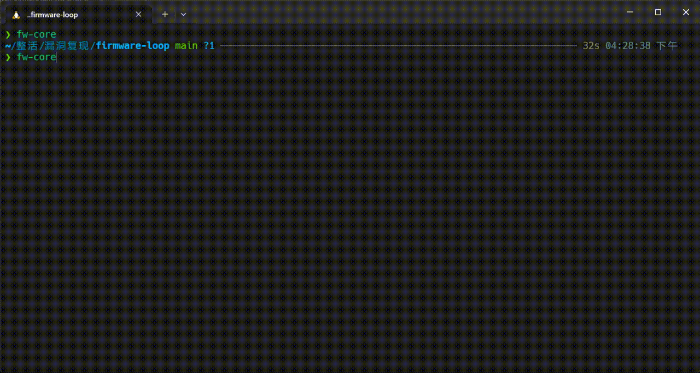

# firmware-loop

**面向 IoT 固件漏洞研究的单 Agent 运行时。**

整合固件获取与解包、服务逆向、动态分析、仿真验证及报告生成。Agent 按漏洞假设选择研究方向；SQLite 持久化攻击面、实验记录和证据，支持上下文压缩与跨会话恢复。

[Quick Start](#quick-start) · [Commands](#commands) · [Configuration](#configuration) · [Design](#design) · [Docs](#docs)



## Quick Start

**Requirements:** Python 3.10+、Git；真实研究需要兼容 OpenAI API 的模型端点。分析工具按需安装。

### Install

```bash
git clone https://github.com/Juryorca/firmware-loop.git
cd firmware-loop
```

选择一种环境管理方式：

<details open>
<summary><b>uv</b></summary>

```bash
uv venv --python 3.12 .venv
source .venv/bin/activate
uv pip install ".[tui]"
```

</details>

<details>
<summary><b>mamba</b></summary>

```bash
mamba create -n firmware-loop python=3.12 pip -y
mamba activate firmware-loop
python -m pip install ".[tui]"
```

</details>

<details>
<summary><b>venv + pip</b></summary>

```bash
python3 -m venv .venv
source .venv/bin/activate
python -m pip install ".[tui]"
```

</details>

以上为 bash/zsh 命令；Windows 请按所用 shell 激活环境。无需 TUI 时，将 `".[tui]"` 改为 `"."`。

### Configure

在仓库根目录创建 `state/model.json`：

```json
{
  "api_key": "<API_KEY>",
  "base_url": "https://api.example.com/v1",
  "model": "<MODEL_ID>"
}
```

也支持环境变量 `FW_MODEL_API_KEY`、`FW_MODEL_BASE_URL`、`FW_MODEL_NAME`（优先级高于 JSON）。使用 Responses API 时，增加 `"api": "responses"`。若 `state/` 不存在，请先创建；该目录已被 Git 忽略。

### Run

```bash
fw-core
```

在 TUI 中输入：

```text
/fw /path/to/firmware.bin
```

也可直接提供设备型号，例如 `/fw <厂商> <型号> <版本>`。Agent 根据输入建立研究目标，开始获取或分析固件；无需提前创建 target 或假设。

在 TUI 中输入 `/help` 查看所有命令与快捷键。常用入口：`/status` 查看研究进度，`/continue` 继续当前研究，`/resume` 恢复历史会话。完整列表见 [Commands](#commands)。

未配置模型时可用 `scripted` 检查 TUI 与运行时；它不执行真实漏洞研究。

<details>
<summary>Print mode / CLI</summary>

```bash
fw-core init target-1
fw-core --target target-1 -p "分析目标的网络入口并提出待验证的漏洞假设"
```

</details>

## Commands

在 TUI 输入 `/help` 可查看当前版本的命令与快捷键。

<details>
<summary>全部 21 条内置命令</summary>

| 命令 | 用途 |
| --- | --- |
| `/fw <固件路径或型号>` | 启动固件研究 |
| `/status` | 查看研究进度与收尾检查 |
| `/hypotheses` | 查看假设队列 |
| `/evidence` | 查看观察与证据 |
| `/continue` | 继续当前研究 |
| `/resume [会话 ID]` | 恢复历史会话 |
| `/new` | 在当前目标下新建会话 |
| `/target [name]` | 选择或切换目标 |
| `/model [name]` | 选择或切换模型 |
| `/budget` | 查看用量与上下文 |
| `/skills` | 查看可用 Skills |
| `/knowledge <query>` | 检索研究知识 |
| `/tools` | 检查工具状态 |
| `/tool-setup` | 检查并配置分析工具 |
| `/mcp` | 查看 MCP 连接 |
| `/compact [instructions]` | 压缩当前会话上下文 |
| `/expand` | 展开或折叠工具输出 |
| `/clear` | 清空当前对话视图（保留研究记录） |
| `/help` | 查看命令与快捷键 |
| `/quit` | 退出 TUI |
| `/提交 <报告>` | 填写厂商提交草稿（不发送） |

</details>

## Configuration

**Workspace.** 当前版本请在克隆的仓库根目录运行 `fw-core`。研究规则、Skills 和工具定义随仓库提供。

**State.** 研究数据保存在 `state/`；固件样本、实验产物与本地数据库不应提交到 Git。

**Tools.** `binwalk`、`unblob`、QEMU、IDA、Ghidra 等由用户按需安装。查看环境中可用的工具：

```bash
fw-core capabilities
fw-core toolset
```

工具缺失或架构不匹配时，相应能力不可用或受限；Python 包不负责安装这些外部程序。

## Design

固件研究需要反复切换视角：静态分析发现可疑入口，动态实验检验它是否可达，实验结果又可能指向另一段代码。研究没有固定的工具调用顺序，下一步取决于刚刚获得的证据。

firmware-loop 采用单 Agent 持续研究一个目标，以**可证伪的漏洞假设**组织工作。每轮明确要验证什么、怎样判断结果，并将新发现纳入后续研究。验证失败也需要归因：假设被否定、环境不具备条件、观测方法无效，分别意味着不同的下一步。一个问题尚未验证完，就不会因为当前实验失败而被当作已经排除。

研究可能跨越多个会话和上下文窗口。已完成的实验、证据来源、未解决的问题与下一步计划独立保存，恢复后可以沿着原来的线索继续。运行时负责记录与一致性检查，模型负责提出和检验假设；漏洞结论最终取决于可复现的证据。

[研究循环](.agents/skills/research-loop/references/LOOP.md) · [运行时架构](docs/ARCHITECTURE.md) · [Pi](https://github.com/badlogic/pi-mono)（运行时设计参考） · [Big Sleep](https://googleprojectzero.blogspot.com/2024/11/from-naptime-to-big-sleep.html)（研究背景）

## Scope

仅用于已授权的固件、设备和网络。Agent 可执行外部命令，建议使用隔离环境；仿真验证不能直接等同于真实设备验证。

## Docs

- [CLI / TUI](docs/APP.md)
- [Architecture](docs/ARCHITECTURE.md)
- [Agent / Skills / Tools](docs/AGENT_ARCHITECTURE.md)
- [Knowledge](docs/KNOWLEDGE.md)
- [Research Loop](.agents/skills/research-loop/references/LOOP.md)
